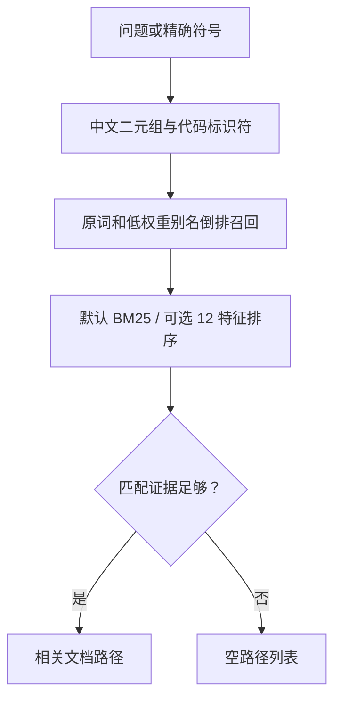

# CPU 文档决策检索器：探索与实现

[← 项目说明](../README.md)

## 目标和当前结论

目标是输入 Agent 当前的问题，输出本仓库内相关的文档路径。检索器不生成仓颉代码或知识答案，只从实际存在的知识页中选择路径。

本次实现以 `cangjie-1.0.5` 的提交 `16d2d4d72e3a2f2a2a17d8b505d5a44a0afb6dac` 为基础，未引入其他语言版本的文档。这个提交的活动知识库位于 `references/`；`docs/` 保存架构、维护和测试说明。恢复遗漏页面后，知识库共 **7605 页**。

实现包含 **C++17 召回器与 12 特征小型排序模型**。独立查询评测中，原生 BM25 排序优于本次小样本训练的排序器，因此默认采用字段加权 BM25 与概念扩展，学习排序器通过 `--learned-ranker` 显式开启。评测后只调整了默认模式与选项，没有根据测试题修改特征、别名或系数。

原有 Python 查询入口和发布流程保持不变。这样可以单独评测路径定位，继续使用原入口的摘要、成员契约、节点展开和渐进披露能力。是否替换现有 Skills 的检索，须根据真实任务反馈决定。

这是一种领域专用的学习排序方案。它没有通用语言模型的理解能力，也不是 Jev 权重的裁剪版。

## 候选方案比较

| 方案 | 优点 | 对本知识库的主要限制 | 本次选择 |
| --- | --- | --- | --- |
| 手写“问题 → 目录”决策树 | 速度快，容易解释 | 跨主题问题容易漏检；新页面和新说法需维护规则 | 用于软特征和同义词，不做唯一入口 |
| 字段加权 BM25 + 中文二元组 | CPU 轻量；API 和工具选项易精确召回 | 零词汇重叠的意译仍可能失败 | 作为召回基础 |
| 小型特征排序器 | 系数很少；可离线训练；结果可解释 | 排序不能补救未召回的文档；依赖训练样本代表性 | 实现 pairwise linear ranker，当前保留为可选实验 |
| fastText 多标签分类 | 可输出多个领域标签，可量化 | 直接预测数千路径属于闭集分类；文档增删和复合查询不方便 | 可另做领域路由实验 |
| BGE-small 中文向量 + 混合检索 | 有望改善口语意译和词汇不重叠 | 需要额外权重、分词器和推理运行时；CPU 收益应实测 | 后续可选召回通道，未纳入本次运行时 |
| Jev / jev-retrieval | 有结构化相关性判定与重排接口 | 相关参考实现的验证、重排调用远程 API | 参考其分层结构，不依赖其服务 |

Jev 官方将其定义为接收 state 与 typed questions、返回结构化判断的模型。`jev-retrieval` 的本地阶段执行 BM25 召回，后续使用远程 Jev 做验证和重排；Rust 编写的客户端本身并不意味着模型在 CPU 本地运行。仅替换语言或手写规则，也不能复制其语义判断能力。

中文实现要特别注意：“泛型、闭包、异常、接口”等常见概念只有两个字。SQLite FTS5 内置 trigram 的 MATCH 无法命中少于三个 Unicode 字符的检索项，因此本方案显式生成中文二元组，同时保留英文完整标识符与驼峰组成部分。

## 构建和使用

需要 Python 3.11+ 和支持 C++17 的编译器。Python 仅在索引构建和训练时使用；查询程序不需要 Python、GPU、NPU、模型服务或第三方 C++ 库。

从仓库根目录执行：

```sh
python scripts/maintenance/build_router.py
build/doc_router/cj-doc-router \
  --index build/doc_router/router.idx \
  --query "ArrayList 如何反转" \
  --query "仓颉泛型的 where 约束怎么写" \
  --top-k 5 --explain
```

`--query` 可以重复，多个独立问题在一个进程内处理。输出 JSON 中每个查询的 `paths` 是按相关性排序的相对路径，形如 `references/api/std/collection/classes/arraylist/reverse.md`。无匹配时返回空列表。可用 `--domain language|std|stdx|tools|examples` 缩小检索范围。

路径相对于仓库根目录。标准发布件只携带 SQLite，不包含这些 Markdown 路径；本原型是开发态可选工具，尚未作为 `.agents/skills/cangjie-coding/` 的跨平台二进制发布。

文档或模型修改后重建索引。检查生成物是否与当前源数据一致：

```sh
python scripts/maintenance/build_router.py --check
```

索引检查需要源文档；原生查询为了保持独立运行，不会逐次读取 Markdown 检测源文件变化。

常驻进程可用 `--stdin`：每行一个 UTF-8 查询，每个查询输出一行 JSON，索引只加载一次。默认使用 BM25 排序，`--bm25-only` 可显式选择同一模式；`--learned-ranker` 选择小型排序模型，作为可选实验。两种模式使用相同的召回与别名扩展。

## 决策过程和模型边界



索引对文档 ID、标题、签名、摘要和正文分别赋予不同词频权重。单字段词频设上限，正文取前 12000 字符参与召回，减少长页面重复符号对结果的干扰。模型指纹仍覆盖完整文档；正文截取意味着只出现在长页面后半部的知识可能漏检，应作为已知限制。

中文按连续汉字生成相邻二元组；英文保留完整标识符，同时拆分 `camelCase` 和 `snake_case`。人工维护的双语别名只展开一轮，权重低于原始词，不递归扩展为无边界的相关词。显式 `--domain` 是硬过滤；查询中的包名或工具名只提供排序特征。

开启 `--learned-ranker` 时，候选的排序分数为 `score(q,d) = Σ w[j] × feature[j](q,d)`：

| 特征 | 作用 |
| --- | --- |
| `log_bm25` | 压缩后的字段加权词汇相关度 |
| `raw_coverage` | 原始查询词的 IDF 加权覆盖率 |
| `title_coverage` | 标题与成员所属对象对查询词的覆盖率 |
| `receiver_match` | 是否匹配请求中的 API 所属类型 |
| `member_match` | 是否匹配请求中的成员名称 |
| `alias_coverage` | 双语概念别名的覆盖率 |
| `exact_selector` | 精确 ID、标题或文档路径匹配 |
| `is_leaf` | 是否为可直接读取的叶子契约或示例 |
| `broad_root` | 是否为宽泛入口或主题索引 |
| `symbol_pair` | 所属类型和成员同时匹配 |
| `domain_match` | 是否符合查询显式提及的包或工具领域 |
| `ascii_coverage` | 英文符号的加权覆盖率 |

精确选择器在普通排序前享有优先级。权重来自离线成对学习；别名、精确选择器优先级和弱匹配门控仍是显式规则。不能把整个系统描述成端到端神经语义模型。

`raw_coverage` 的分母包含已知词的 IDF，并给未知词加入固定代价，避免无关长句只命中一个普通词就获得满覆盖率。这仍不能保证问题属于仓颉领域。无关问题如果碰巧共享若干普通词，仍可能返回结果；`no_match` 是匹配证据门控，不是经过训练的“知识库可回答性”判定。排序分数也不是相关概率或已校准置信度。

## 离线训练与维护

运行时只读取生成索引，不学习、不访问网络。训练流程使用原生程序导出与查询完全相同的特征，从 BM25 候选中挖掘负例，再最小化带初始系数 L2 约束的 pairwise logistic loss。先验系数用于约束小样本训练，不能将全部效果归因于学习。

```sh
python scripts/maintenance/build_router.py
python scripts/maintenance/train_router.py
python scripts/maintenance/build_router.py
python scripts/maintenance/train_router.py --check
python scripts/maintenance/build_router.py --check
```

训练输入是 `native/doc_router/model/training_queries.json`，本次包含 36 条查询、2268 对正负样本；导出的 `ranker.json` 保存特征顺序、权重、训练数据哈希、样本数量、训练参数与损失。构建程序将权重和别名写入索引，查询阶段不用解析这些 JSON。修改系数后必须重建索引。

训练标注将未列为正例的候选作为负例，可能存在漏标，因此应仔细补充可替代的相关页面。建议后续收集 Agent 实际采用、忽略和补查的文档，人工审计后扩充训练数据；按任务或主题分割新的验证集。已经用于分析失败原因的测试集不能继续称为新的盲测。

索引采用带版本头的 little-endian 二进制格式，生成结果可复现；运行时检查大小、UTF-8、重复文档、路径格式、倒排顺序、有限数值与特征数量。输出的 `corpus_hash` 是源文档与模型配置的联合指纹。`--check` 校验当前文档、规则和模型共同生成的指纹与索引字节。它不是运行时文件校验和，也不提供对不可信分发源的真实性认证。

## 源知识库修复

原始提交有 96 个 manifest 已列出、但 Git 未跟踪的知识页。通用 `build/`、`env/` 忽略规则同时排除了知识目录中的同名路径。本次将这两条规则限定到仓库根目录，并从原提交的 `knowledge.sqlite3` 恢复原文，逐页核对数据库保存的 SHA-256。7605 页全部与原数据库正文哈希一致，没有改写知识内容。

同时修复 Python 3.11/3.12 的 `gzip.compress(mtime=0)` 平台 OS 字节差异：改用 `GzipFile` 写出稳定头部，压缩内容和已有发布数据库不变。`python build.py --check` 已可在当前 Linux 环境通过。

## 评测方法

```sh
python -m unittest discover -s scripts/tests -p 'test_native_router.py' -v
python scripts/evaluation/evaluate_router.py --ablation --output reports/router-evaluation.json
```

评测集与训练查询分开编写，先审计相关文档标注，再冻结规则、特征和模型，最后执行评测。测试页面仍正常存在于全文索引中，这属于查询留出评测，不是把测试文档从知识库移除。

各标注路径是可用答案的替代入口，未宣称穷尽所有相关文档，因此报告 **Hit@1、Hit@5 和 MRR@5**，不把这些数字称为完整文档集合的 Recall。无关问题的空结果准确率单独统计，不放进正例命中率分母。

性能分别测量新进程单查询、包含加载的整批查询，以及 `--stdin` 常驻进程完成首次预热后的单查询。常驻耗时包含管道与 JSON 开销；操作系统文件缓存未清除，所谓冷启动是进程冷启动，不是磁盘冷启动。Linux `/usr/bin/time` 提供峰值 RSS 和 CPU 时间。通用服务器上的测试结果不能直接代表开发板性能。

评测脚本只读取知识与模型，保存每条问题的结果和标签供复核，不根据测试结果更新别名或系数。公开测试集之后的迭代应另设新留出集。

## 本次结果与方案选择

完整原始数据与逐题结果见 [router-evaluation.json](data/router-evaluation.json)。固定评测集共 66 条，正例 58 条、领域外负例 8 条；是人工合成的查询留出集，不是真实 Agent 流量。此次测试用于选择默认算法，后续上线验收仍应使用新样本。

| 方案 | Hit@1 | Hit@5 | MRR@5 | 正例空结果 |
| --- | ---: | ---: | ---: | ---: |
| 原 Python 查询器 | 43.10%（25/58） | 67.24%（39/58） | 0.5161 | 9 |
| **原生 BM25 + 概念扩展，默认** | **74.14%（43/58）** | **84.48%（49/58）** | **0.7874** | 7 |
| 原生 12 特征学习排序，可选 | 63.79%（37/58） | 75.86%（44/58） | 0.6839 | 11 |

三种方案均正确拒绝 6/8 个领域外问题，均有 2 个误检。不能将这个小负例集的 75% 拒绝率当作稳定的线上安全门控能力。

| 正例类型 | 数量 | 原 Python Hit@5 | 默认原生 Hit@5 |
| --- | ---: | ---: | ---: |
| 精确符号 | 12 | 12/12 | 12/12 |
| 中文自然问句 | 16 | 4/16 | 12/16 |
| 语义和概念问题 | 12 | 8/12 | 8/12 |
| 中英复合任务 | 12 | 10/12 | 12/12 |
| 歧义短查询 | 6 | 5/6 | 5/6 |

原生方案明显改善了中文自然问句和复合任务，在本测试集上保留了精确符号表现。概念问题仍是短板，如隐式整数转换、多继承、失败类型转换等问句可能被拒绝；`JSON` 这样的宽词也可能偏向具体成员而遗漏概念入口。这些失败样例已经保留在报告中，本轮没有据此增补规则。

小型排序器的训练损失由 0.02101830 降到 0.01894197，但查询留出效果更差：强结构特征会把答案排到契约并不完整的相邻页，排序后的首项也会影响弱证据门控。现有 36 条标注和手工先验不足以覆盖复杂的自然问句。保留其训练和导出流程，便于后续扩充真实查询再验证；当前不推荐把该排序器设为默认。

性能测试环境为 Linux x86_64、AMD EPYC 9V74、Python 3.12.14、g++ 14.2.0；查询程序为单进程，未采用 GPU/NPU。以下冷进程数据取 3 次中位数：

| 测量 | 原 Python | 默认原生 |
| --- | ---: | ---: |
| 单条精确查询，含新进程启动 | 406.839 ms | 58.718 ms |
| 66 条查询整批，含加载 | 3841.196 ms | 166.880 ms |
| 单条冷进程峰值 RSS | 51.59 MiB | 24.14 MiB |
| 66 条整批峰值 RSS | 54.03 MiB | 33.83 MiB |
| 常驻单查询中位数 / P95 | 未测量 | 1.222 / 4.867 ms |

RSS 由每个子进程的 `wait4` 使用量读取；常驻查询为首次预热后依次执行的 58 条正例。原生默认只输出路径，Python 还输出摘要与契约元数据，因此耗时差异包含输出工作量差异，不能全部归因于 C++。索引大小为 6,135,004 字节，包含 30,528 个词项、527,951 条倒排记录；线性模型只有 12 个系数，但索引与规则也是系统成本。

建议下一步优先收集真实任务、审计相关页面、丰富独立训练标注，再比较小型树模型或线性模型。若主要失败来自完全意译、缺乏词汇重叠，再评测 CPU 量化的中文向量召回通道。已有基线和独立测试工具可用于判断每一项投入是否值得。

本次验证：`python -m unittest discover -s scripts/tests -v` 共 136 项，135 项通过、1 项环境跳过；`python build.py --check`、原生索引 `--check`、训练 `--check` 均通过；知识结构检查核对 7605 条记录、17885 个链接，无警告或错误。

## 相关资料

- [TypeSafe：Jev 与 typed decisions](https://docs.typesafe.ai/introduction)
- [jev-retrieval：本地 BM25 与远程 Jev 验证、重排](https://github.com/romeromarcelo/jev-retrieval)
- [SQLite FTS5：trigram tokenizer](https://sqlite.org/fts5.html#the_trigram_tokenizer)
- [fastText：分类、top-k 标签与模型量化](https://fasttext.cc/docs/en/cheatsheet.html)
- [BAAI：bge-small-zh-v1.5 模型卡](https://huggingface.co/BAAI/bge-small-zh-v1.5)
- [ONNX Runtime：CPU 量化方法](https://onnxruntime.ai/docs/performance/model-optimizations/quantization.html)

以上项目的通用基准不能作为本仓库的效果证据。本次运行时独立实现，不包含这些项目的模型权重或源码。
